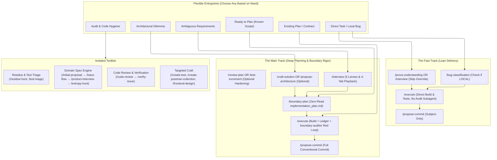

# Get-Thing-Done (GTD) Framework - Antigravity

Systematic agent workflows that enforce deep architectural reasoning over fast code generation—ensuring AI builds exactly what you want with zero-regression reliability.

## Installation & Architecture

### Global Install (available everywhere)

**Linux/macOS:**

```bash
git clone https://github.com/Hoang604/get-thing-done.git gtd-temp
cd gtd-temp && chmod +x *.sh && ./install.sh
cd .. && rm -rf gtd-temp
```

**Windows:**

> [!NOTE]
> Windows does not have a default/native install script. On Windows, run the installation inside **WSL (Windows Subsystem for Linux)** or a POSIX-compatible environment using the Linux/macOS command above.

### Single Source of Truth (SSoT) & Synchronization
- **Source of Truth (`.gemini/antigravity-cli/`)**: The definitive home for all **Skills** (`skills/`) and **Custom Subagents** (`agents/`).
- **Sync Script (`./sync_workflows.sh`)**: Synchronizes skills and agents from `.gemini/antigravity-cli/` to the packaging directories (`.gemini/config/` for global and `.agents/` for workspace).
- **Global Deployment (`./install.sh`)**: Copies the framework into `~/.gemini/` and `~/.agents/` for machine-wide availability.

---

## 1. Modular Execution Model

The GTD framework is **not an inflexible waterfall pipeline**. Each skill and custom subagent is an **autonomous, loosely coupled building block** with clean input/output boundaries. You can enter at any point based on the problem at hand:



---

## 2. Core Tracks

### ⚡ The Fast Track (Lean Delivery)
*For focused bug fixes, single-module enhancements, or straightforward tasks with minimal ceremony and zero subagent latency.*

- **[prove-understanding](.gemini/antigravity-cli/skills/prove-understanding/SKILL.md)**: 1-shot confirmation to prove understanding before building, bypassing exploratory questioning.
- **[interview](.gemini/antigravity-cli/skills/interview/SKILL.md)** (Skip Override): Saying *"skip it"* or *"just build"* outputs `[ALIGNED-SKIPPED]` and proceeds immediately without questioning rounds.
- **[bug-classification](.gemini/antigravity-cli/skills/bug-classification/SKILL.md)**: Runs the Seam Sufficiency Test. If `LOCAL`, the fix is internal to a sound seam—remediate directly with zero planning overhead.
- **[execute](.gemini/antigravity-cli/skills/execute/SKILL.md)**: Runs against any contract or simple plan. Bypasses subagents when no `Subagent Spawn Directive` is declared, executing build and baseline verification directly.
- **[propose-commit](.gemini/antigravity-cli/skills/propose-commit/SKILL.md)**: Outputs a concise single-line subject for simple changes.

### 🏛️ The Main Track (Deep Planning & Boundary Rigor)
*For high-blast-radius changes, multi-module refactors, or new subsystems where leaking boundaries or hidden assumptions cause failure.*

1. **[interview](.gemini/antigravity-cli/skills/interview/SKILL.md)**: Explores callees and callers across 5 Universal Lenses and enforces the 4-Tab Playback Gate (`[ALIGNED]`).
2. **Architectural Exploration** *(Optional)*:
   - **[craft-solution](.gemini/antigravity-cli/skills/craft-solution/SKILL.md)**: Autonomous `Solution Architect` drafts Approach A (Pragmatic) vs Approach B (Robust) across Quality Tiers 1–5.5, falsified by `proposal-auditor`.
   - **[propose-architecture](.gemini/antigravity-cli/skills/propose-architecture/SKILL.md)**: Decomposes macro subsystems into a boundary DAG, arbitrated per node by `architecture-adjudicator`.
3. **[boundary-plan](.gemini/antigravity-cli/skills/boundary-plan/SKILL.md)**: Generates a zero-read `implementation_plan.md` artifact with Users, Jobs, Use Scenarios (`S-xx`), Invariants (`I-xx`), non-nullable contracts, and embedded auditor directives.
4. **Pre-Execution Hardening** *(Optional)*:
   - **[review-plan](.gemini/antigravity-cli/skills/review-plan/SKILL.md)**: Dispatches `plan-reviewer` to independently reconstruct Day-One Design and audit against Maximal Value, Day-One Test, and Boundary Principles.
   - **[test-increment](.gemini/antigravity-cli/skills/test-increment/SKILL.md)**: Injects adversarial test seams with `Breaks-If Mutation` failure triggers into Sections 4.B and 5 of the plan.
5. **[execute](.gemini/antigravity-cli/skills/execute/SKILL.md)**: Builds milestones sequentially (`implementation_ledger.md`), evaluates user scenarios, and runs the Verify & Remediate loop with `boundary-auditor` up to the declared budget.
6. **[propose-commit](.gemini/antigravity-cli/skills/propose-commit/SKILL.md)**: Synthesizes final state into subject + Context sentence + 2–3 key achievement bullets.

---

## 3. Specialized Custom Subagents (Air-Gapped Delegation)

GTD delegates complex audits to autonomous subagents in `.gemini/antigravity-cli/agents/`:

| Subagent | Role | Primary Responsibility |
|---|---|---|
| **[plan-reviewer](.gemini/antigravity-cli/agents/plan-reviewer.md)** | Plan Standards Auditor | Reconstructs Day-One Design and audits plans against Maximal Value, Day-One Test, and Boundary Principle (`review-plan`). |
| **[boundary-auditor](.gemini/antigravity-cli/agents/boundary-auditor.md)** | Systems Code Auditor | Audits code against milestone outcomes, scenario coverage, and transition residue (`execute` Red Loop). |
| **[codebase-auditor](.gemini/antigravity-cli/agents/codebase-auditor.md)** | Spec Feasibility Auditor | Audits product drafts against codebase reality to block unintegrable requirements and speculation traps (`entropy-hunt`). |
| **[issue-verifier](.gemini/antigravity-cli/agents/issue-verifier.md)** | Review Finding Tester | Tests code-review findings against whole codebase (True/False Positive) and classifies by seam sufficiency (`verify-issue`). |
| **[residue-hunter](.gemini/antigravity-cli/agents/residue-hunter.md)** | Past Residue Auditor | Hunts obsolete code forms and bridges under a 5-minute budget, classifying `LAZY` vs `WEAK` author failure (`residue-hunt`). |
| **[test-triager](.gemini/antigravity-cli/agents/test-triager.md)** | Test Contract Auditor | Evaluates test suites across Contract, Mutant Killing, Refactor Survival, and Reach to classify tests as `REAL` vs `JUNK` (`test-triage`). |
| **[architecture-adjudicator](.gemini/antigravity-cli/agents/architecture-adjudicator.md)** | DAG Boundary Arbiter | Arbitrates competing boundary proposals, enforces non-nullable contracts, and prunes DAG branches (`propose-architecture`). |
| **[proposal-auditor](.gemini/antigravity-cli/agents/proposal-auditor.md)** | Proposal Falsifier | Adversarially checks solution claims against codebase evidence before proposing plans to user (`craft-solution`). |
| **[ux-auditor](.gemini/antigravity-cli/agents/ux-auditor.md)** | UI Friction Auditor | Audits presentation boundaries for operational economy, stranded context, and architectural subservience. |

---

## 4. Standalone Toolkits (On-Demand)

These capabilities run independently of any delivery pipeline:

### 📐 Domain Specification Engine
*Used upstream for complex or ambiguous requirements before writing code:*
- **[initial-proposal](.gemini/antigravity-cli/skills/initial-proposal/SKILL.md)**: Zero-code domain interview extracting raw business intent into `proposal.md`.
- **[trace-flow](.gemini/antigravity-cli/skills/trace-flow/SKILL.md)**: Traces causal execution paths from ingress membrane to terminal egress into `codebase-trace.md`.
- **[product-interview](.gemini/antigravity-cli/skills/product-interview/SKILL.md)**: Reconciles domain proposals with codebase realities into `product-draft.md`.
- **[entropy-hunt](.gemini/antigravity-cli/skills/entropy-hunt/SKILL.md)**: Spawns `codebase-auditor` to eliminate domain ambiguities and lock `product-spec-locked.md` (`[ENTROPY = 0: LOCKED]`).

### 🔍 Code Quality & Review
*Used to evaluate pull requests, commits, or existing code:*
- **[code-review](.gemini/antigravity-cli/skills/code-review/SKILL.md)**: Blind code quality review judging structure and runtime behavior from the source alone.
- **[verify-issue](.gemini/antigravity-cli/skills/verify-issue/SKILL.md)**: Dispatches `issue-verifier` to test review findings across the codebase and classify confirmed defects as `LOCAL` or `ARCHITECTURAL`.

### 🧹 Debt Hunting & Test Triage
*Used for codebase maintenance and test suite hygiene:*
- **[residue-hunt](.gemini/antigravity-cli/skills/residue-hunt/SKILL.md)**: Dispatches `residue-hunter` with a 5-minute budget to surface transition residue and obsolete bridges.
- **[test-triage](.gemini/antigravity-cli/skills/test-triage/SKILL.md)**: Dispatches `test-triager` to classify tests as `REAL` (guards true invariants) or `JUNK` (pins fragile outcomes).

### 🛠️ Targeted Craft & Testing Utilities
- **[create-test](.gemini/antigravity-cli/skills/create-test/SKILL.md)**: Designs interactive test plans with mutation proofs (fault injection red → green).
- **[create-postman-collection](.gemini/antigravity-cli/skills/create-postman-collection/SKILL.md)**: Generates schema-validated Postman v2.1 JSON collections with automated token setup and `Breaks-If` assertions.
- **[frontend-design](.gemini/antigravity-cli/skills/frontend-design/SKILL.md)**: Guidance for distinctive, production-grade frontend aesthetics avoiding generic AI templates.
- **[spawn-subagent](.gemini/antigravity-cli/skills/spawn-subagent/SKILL.md)**: Cold-read delegation primitive enforcing the Problem-Solution Boundary Principle.
- **[short](.gemini/antigravity-cli/skills/short/SKILL.md)**: Utility to force concise, 1-sentence answers.
- **[write-great-skills](.gemini/antigravity-cli/skills/write-great-skills/SKILL.md)**: Meta-framework enforcing Root 1 (Causes), Root 2 (Goals), and Independent rules for authoring skills.

---

## 5. Hook-ins & Interceptors (Safeguards & Circuit Breakers)

Dynamic interceptors that plug into execution upon specific events or risk conditions:

- **[context-loss](.gemini/antigravity-cli/skills/context-loss/SKILL.md) (Compaction Recovery Hook)**: Automatically triggered upon context compaction. Re-anchors to `implementation_plan.md` or active audit artifacts and resumes execution seamlessly without re-asking questions.
- **[safe](.gemini/antigravity-cli/skills/safe/SKILL.md) (High-Risk Operation Interceptor)**: Intercepts destructive commands, bulk mutations, speculative domain code, semantic git conflicts, and delete collisions. Emits a `### 🛡️ Safe Guard` report and halts execution until explicit user approval.
- **Circuit Breakers in [execute](.gemini/antigravity-cli/skills/execute/SKILL.md)**:
  - **`PLAN VETO`**: Triggered by `boundary-auditor` if the plan itself contains structural flaws or transition residue. Halts execution immediately.
  - **`Audit Budget`**: Hard stop when maximum remediation cycles are exhausted.
  - **`Oscillation Check`**: Detects ping-pong loops ($A \to B \to A$) and halts for human intervention.
