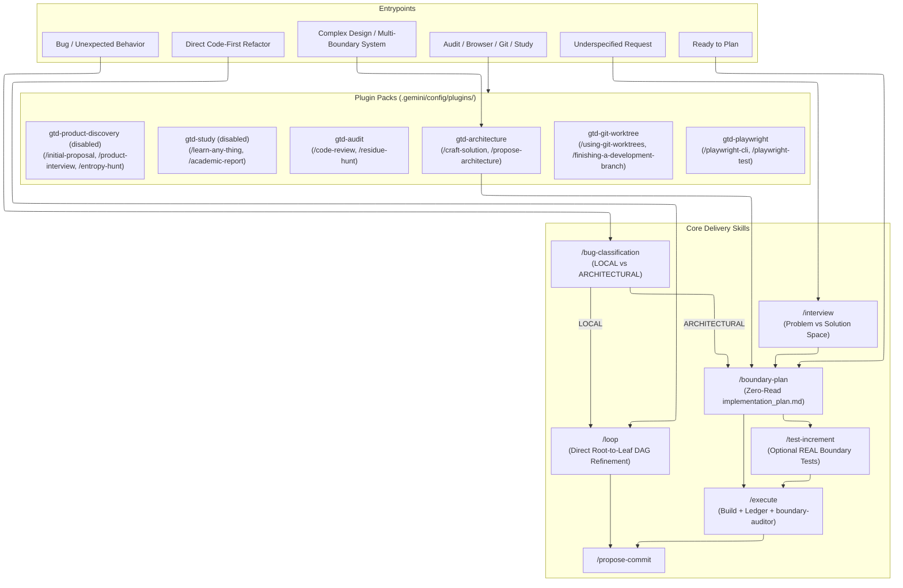

# Get-Thing-Done (GTD) Framework

Systematic agent workflows that prioritize boundary clarity, verified codebase reality, and minimal system entropy over fast, speculative code generation.

## Installation & Architecture

### Global Install

**Linux / macOS:**

```bash
git clone https://github.com/Hoang604/get-thing-done.git gtd-temp
cd gtd-temp && chmod +x *.sh && ./install.sh
cd .. && rm -rf gtd-temp
```

**Windows:**

> [!NOTE]
> Windows does not have a native install script. Run the Linux/macOS command inside **WSL (Windows Subsystem for Linux)** or a POSIX-compatible shell.

### Single Source of Truth (SSoT) & Sync

- **Core Skills & Subagents (`.gemini/antigravity-cli/`)**: SSoT for core skills (`skills/`) and custom subagents (`agents/`).
- **Plugins (`.gemini/config/plugins/`)**: SSoT for modular optional/domain skill packs (`plugin.json` + `skills/`).
- **Global Rules (`.gemini/GEMINI.md`)**: SSoT for shared global instructions extracted into `.agents/AGENTS.md`.
- **Sync (`./sync_workflows.sh`)**: Mirrors core skills, subagents (including OpenCode V2 frontmatter conversion to `.agents/opencode/agents/`), plugins, and shared rules to `.gemini/config/` and `.agents/`.
- **Install (`./install.sh`)**: Deploys `.gemini/`, `.agents/`, `.codex/hooks/`, and OpenCode configs/plugins/agents into `$HOME`.

---

## 1. Modular Execution Model

GTD is a set of loosely coupled building blocks rather than a rigid waterfall. Enter at the skill or plugin that matches the uncertainty and blast radius of your task:



---

## 2. Core Skills

All core skills live in `.gemini/antigravity-cli/skills/`. Skills marked **auto-invocable** can be picked up automatically by the agent when their trigger condition holds; skills marked **manual** are invoked explicitly via `/<skill-name>`.

### Planning, Delivery & UI

| Skill | Invocation | What it does | When to use |
|---|---|---|---|
| **[interview](.gemini/antigravity-cli/skills/interview/SKILL.md)** | Auto / `/interview` | Locks Specification Level (Problem vs. Solution space), grounds gaps in workspace code, runs dependency-ordered question rounds, and outputs a final specification playback. | Requirements are underspecified, multiple valid paths exist, or the request conflicts with current code. |
| **[bug-classification](.gemini/antigravity-cli/skills/bug-classification/SKILL.md)** | Auto / `/bug-classification` | Traces a defect to its root-cause layer and runs the Seam Sufficiency Test to classify it as `LOCAL` (fixable behind an existing sound seam) or `ARCHITECTURAL` (Layer 3 flaw or seam change). | A bug, failure, or unexpected behavior appears and you need to decide whether to patch in place or redesign a boundary. |
| **[boundary-plan](.gemini/antigravity-cli/skills/boundary-plan/SKILL.md)** | Auto / `/boundary-plan` | Produces a zero-read `implementation_plan.md` structured as a topological sequence of boundaries with Users, Jobs, Use Scenarios, Invariants, Retirement Inventory, and exact contracts. | Non-trivial features, multi-module refactors, or high-blast-radius changes where hidden callers or legacy residue cause regressions. |
| **[test-increment](.gemini/antigravity-cli/skills/test-increment/SKILL.md)** | Manual (`/test-increment`) | Designs REAL boundary tests (contract-driven, mutant-killing, refactor-surviving) for an active `boundary-plan` and embeds them into each milestone and the Verification Matrix. | After drafting `implementation_plan.md` and before execution, when you want boundary verification tests baked into the plan. |
| **[execute](.gemini/antigravity-cli/skills/execute/SKILL.md)** | Auto / `/execute` | Executes an approved plan milestone by milestone, maintains `implementation_ledger.md`, runs baseline checks, and drives the Verify & Remediate loop with `boundary-auditor`. | An `implementation_plan.md` is approved and ready to build with audit gates and deviation tracking. |
| **[loop](.gemini/antigravity-cli/skills/loop/SKILL.md)** | Manual (`/loop`) | Maps the task's mutable scope and dependency DAG into `loop_dag.md`, then refines every node directly on disk from root to leaf under Maximal Yield, Day-One Test, and Deletion Test rules. | Direct code-first refactors or cleanup passes where you want disciplined root-to-leaf execution without full `boundary-plan` ceremony. |
| **[ui](.gemini/antigravity-cli/skills/ui/SKILL.md)** | Auto / `/ui` | Guides UI design, implementation, and review across visual hierarchy, layout geometry, typography, color contrast, accessibility, and interactive states. | Building, modifying, or reviewing frontend layouts, components, and interactive pages. |

### Analysis, Testing Hygiene & Utilities

| Skill | Invocation | What it does | When to use |
|---|---|---|---|
| **[trace-flow](.gemini/antigravity-cli/skills/trace-flow/SKILL.md)** | Manual (`/trace-flow`) | Traces an end-to-end execution path from ingress to egress across modules and generates a causal architectural report. | Understanding how a real request, job, or event propagates through an unfamiliar or complex codebase before changing it. |
| **[explain](.gemini/antigravity-cli/skills/explain/SKILL.md)** | Manual (`/explain`) | Explains code and mechanisms in direct, accurate natural language—system context, responsibility, and internal flow—before showing code. | Asking for an exact technical walkthrough of existing code without oversimplification. |
| **[test-triage](.gemini/antigravity-cli/skills/test-triage/SKILL.md)** | Manual (`/test-triage`) | Dispatches `test-triager` to evaluate every test in scope and classify each as `REAL` (guards consumer contracts) or `JUNK` (brittle or redundant). | Auditing and pruning noisy, brittle, or low-signal test suites. |
| **[propose-commit](.gemini/antigravity-cli/skills/propose-commit/SKILL.md)** | Manual (`/propose-commit`) | Synthesizes verified workspace changes into a Conventional Commit message. | Changes are tested and ready to commit. |
| **[safe](.gemini/antigravity-cli/skills/safe/SKILL.md)** | Manual (`/safe`) | Safeguard gate presenting rationale, blast radius, assumptions, and contingency before proceeding on risky actions. | Running destructive commands, speculative domain mutations, or resolving semantic git / modify-delete conflicts. |
| **[spawn-subagent](.gemini/antigravity-cli/skills/spawn-subagent/SKILL.md)** | Manual (`/spawn-subagent`) | Delegates work to a fresh subagent through a self-contained cold-read prompt resolving references by disk path or inline content. | Offloading an isolated task to a subagent without leaking parent context or distorting the user's request. |
| **[write-skills](.gemini/antigravity-cli/skills/write-skills/SKILL.md)** | Manual (`/write-skills`) | Meta-framework for authoring and auditing skills around Root 1 (Decision/Cause/Generality), Root 2 (Goal/Condition), and attention economy. | Creating, updating, or reviewing skills, custom subagents, or instruction files. |

---

## 3. Plugins

Plugins live in `.gemini/config/plugins/<plugin-name>/` with a `plugin.json` manifest. Plugins marked **Disabled by default** set `"disabled": true` in `plugin.json` and can be enabled when needed.

### `gtd-architecture` *(Enabled)*
- **When to use**: Before `boundary-plan`, when a problem has competing architectural directions or spans multiple subsystems that need upfront contract design and adversarial review.
- **Skills**:
  - **[craft-solution](.gemini/config/plugins/gtd-architecture/skills/craft-solution/SKILL.md)**: Delegates to an autonomous `self` subagent to craft competing design approaches and audit them via `proposal-auditor` without bloating parent context. *Use when* solving a hard subsystem design decision with trade-offs.
  - **[propose-architecture](.gemini/config/plugins/gtd-architecture/skills/propose-architecture/SKILL.md)**: Decomposes large multi-boundary systems into a boundary DAG, defines shared invariants, and adjudicates exported contracts via `architecture-adjudicator`. *Use when* architecting a greenfield or multi-service system.

### `gtd-audit` *(Enabled)*
- **When to use**: Reviewing pull requests, commits, specific modules, or an entire repository for security vulnerabilities, runtime/architecture/performance defects, or leftover transition debt.
- **Skills**:
  - **[code-review](.gemini/config/plugins/gtd-audit/skills/code-review/SKILL.md)**: Dispatches parallel `security-reviewer` + `architecture-perf-reviewer` pairs (automatically sharded above 500 KB, 10-minute budget per subagent), classifies every confirmed finding as `LOCAL` or `ARCHITECTURAL` under [review-contract.md](.gemini/config/plugins/gtd-audit/skills/code-review/review-contract.md), and produces an indexed main report that writes full entries only for merged/conflicting/chained items while linking untouched findings directly to subagent reports. *Use when* running a blind, evidence-backed code review.
  - **[residue-hunt](.gemini/config/plugins/gtd-audit/skills/residue-hunt/SKILL.md)**: Dispatches `residue-hunter` (5-minute budget) to surface obsolete code forms, legacy bridges, and transition residue, classifying author failure as `LAZY` vs. `WEAK`. *Use when* verifying a refactor left zero dead paths or hunting accumulated migration debt.

### `gtd-git-worktree` *(Enabled)*
- **When to use**: Isolating feature or plan execution from your primary checkout and cleanly integrating the branch once all checks pass.
- **Skills**:
  - **[using-git-worktrees](.gemini/config/plugins/gtd-git-worktree/skills/using-git-worktrees/SKILL.md)**: Creates or verifies an isolated workspace via native tools or `git worktree` before making edits. *Use when* starting parallel feature work or executing a plan without disturbing your current working tree.
  - **[finishing-a-development-branch](.gemini/config/plugins/gtd-git-worktree/skills/finishing-a-development-branch/SKILL.md)**: Guides final verification and branch integration choices (merge, PR, keep, or discard). *Use when* implementation and tests are complete and you need to close out a development branch.

### `gtd-playwright` *(Enabled)*
- **When to use**: Working with web applications in a live browser or authoring/debugging automated Playwright test suites.
- **Skills**:
  - **[playwright-cli](.gemini/config/plugins/gtd-playwright/skills/playwright-cli/SKILL.md)**: Drives a live browser via `playwright-cli` to inspect rendered DOM snapshots, walk through UI flows, capture console/network errors, manipulate storage/network state, record traces, and interactively debug failing tests. *Use when* inspecting a running app, reproducing UI bugs, or diagnosing why an E2E test fails.
  - **[playwright-test](.gemini/config/plugins/gtd-playwright/skills/playwright-test/SKILL.md)**: Writes, debugs, and scales `@playwright/test` suites (TypeScript/JavaScript) using modern Playwright (up to 1.64) patterns—accessible locators, web-first assertions, auth/mocking, realtime/multi-user coverage, CI setup, and REAL-test standards. *Use when* writing or refactoring automated Playwright E2E/integration test files.

### `gtd-product-discovery` *(Disabled by default)*
- **When to use**: Upstream product discovery for complex, ambiguous business requirements before technical design—enable to run the 4-stage Domain Spec Engine (`initial-proposal` → core `trace-flow` → `product-interview` → `entropy-hunt`).
- **Skills**:
  - **[initial-proposal](.gemini/config/plugins/gtd-product-discovery/skills/initial-proposal/SKILL.md)** *(Stage 1)*: Zero-code interview capturing raw business intent, scope boundaries, and domain vocabulary before reading code. *Use when* starting from a raw product idea or business brief.
  - **[product-interview](.gemini/config/plugins/gtd-product-discovery/skills/product-interview/SKILL.md)** *(Stage 3)*: Codebase-grounded domain interview reconciling the Stage 1 proposal and Stage 2 `trace-flow` trace into a product draft. *Use when* aligning business rules with real codebase constraints.
  - **[entropy-hunt](.gemini/config/plugins/gtd-product-discovery/skills/entropy-hunt/SKILL.md)** *(Stage 4)*: Dispatches `codebase-auditor` to adversarially eliminate spec ambiguities and unintegrable requirements, locking a zero-entropy specification. *Use when* hardening a product draft before architectural design or planning.

### `gtd-study` *(Disabled by default)*
- **When to use**: Deep technical learning or academic writing outside normal software delivery—enable during dedicated study or report-writing sessions.
- **Skills**:
  - **[learn-any-thing](.gemini/config/plugins/gtd-study/skills/learn-any-thing/SKILL.md)**: Two-phase interactive tutor that maps prerequisite knowledge with operational depth probes, then teaches strictly one building block per turn in bottom-up causal order using domain-native mechanics. *Use when* learning a complex subject or mechanism from first principles.
  - **[academic-report](.gemini/config/plugins/gtd-study/skills/academic-report/SKILL.md)**: Standardizes peer-level academic tone and monolingual domain terminology in Vietnamese/specialized technical writing. *Use when* drafting or polishing formal academic or research reports.

---

## 4. Custom Subagents

Autonomous subagents live in `.gemini/antigravity-cli/agents/` and are invoked by core skills and plugins for air-gapped verification and review:

| Subagent | Role | Primary Responsibility | Used By |
|---|---|---|---|
| **[security-reviewer](.gemini/antigravity-cli/agents/security-reviewer.md)** | Security Reviewer | Blind review under adversarial and trust-boundary principles with `LOCAL`/`ARCHITECTURAL` classification. | `gtd-audit:code-review` |
| **[architecture-perf-reviewer](.gemini/antigravity-cli/agents/architecture-perf-reviewer.md)** | Architecture & Perf Reviewer | Blind review for runtime correctness, concurrency, resource lifecycle, performance, integrity, entropy, and clarity with `LOCAL`/`ARCHITECTURAL` classification. | `gtd-audit:code-review` |
| **[boundary-auditor](.gemini/antigravity-cli/agents/boundary-auditor.md)** | Systems Code Auditor | Zero-trust verification of code against `boundary-plan` outcomes, scenarios, invariants, and transition residue. | `execute` |
| **[residue-hunter](.gemini/antigravity-cli/agents/residue-hunter.md)** | Transition Residue Auditor | Hunts obsolete code forms and bridges under a 5-minute budget, classifying `LAZY` vs. `WEAK`. | `gtd-audit:residue-hunt` |
| **[test-triager](.gemini/antigravity-cli/agents/test-triager.md)** | Test Contract Auditor | Classifies tests as `REAL` vs. `JUNK` across Contract, Mutant Killing, Refactor Survival, and Reach. | `test-triage` |
| **[architecture-adjudicator](.gemini/antigravity-cli/agents/architecture-adjudicator.md)** | DAG Boundary Arbiter | Arbitrates boundary proposals, calibrates quality tiers, enforces Day-One honesty, and prunes DAG branches. | `gtd-architecture:propose-architecture` |
| **[proposal-auditor](.gemini/antigravity-cli/agents/proposal-auditor.md)** | Proposal Falsifier | Adversarially audits solution proposals against codebase reality before presenting options. | `gtd-architecture:craft-solution` |
| **[codebase-auditor](.gemini/antigravity-cli/agents/codebase-auditor.md)** | Spec Feasibility Auditor | Adversarially audits product drafts against codebase reality to block unintegrable specs. | `gtd-product-discovery:entropy-hunt` |

---

## 5. Runtime Hooks & Execution Safeguards

- **Lifecycle Hooks ([hooks.json](.gemini/config/hooks.json))**: Automates operational guardrails across tool calls and turns—including `context-budget-guard` and `compact-threshold-tracker` (context budget management), `worktree-isolation-guard` (prevents accidental cross-worktree edits), `decision-harvester` (captures system-shaping decisions), `critical-instructions`, `loop-hook`, `read-file-widener`, `run-command-wait`, `skill-usage-tracker`, and `statusline-tracker`.
- **Execution Circuit Breakers ([execute](.gemini/antigravity-cli/skills/execute/SKILL.md))**:
  - **`PLAN VETO`**: Raised by `boundary-auditor` when the plan itself has structural flaws; halts only on parts unresolved by global/project rules.
  - **`Audit Budget`**: Hard stop once the plan's remediation round budget is exhausted.
  - **Automated Verification Gate**: Closes an audit round without extra subagent rounds only when changed sites are directly exercised by passing checks and retired forms return zero unintended `rg` hits.
